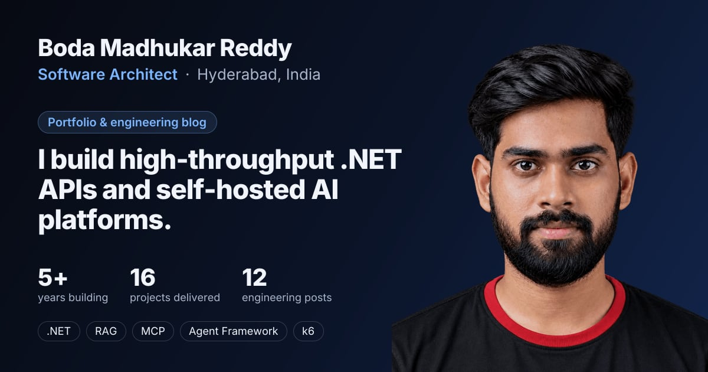

# Hi, I'm Boda Madhukar Reddy

**Software Architect at Revalsys Technologies** (2021 – Present) · Hyderabad, India

I design high-throughput .NET APIs, build self-hosted AI platforms (RAG, MCP, Microsoft Agent Framework, hybrid search), and load-test everything with k6 and Grafana. Production-first: diagnose fast, fix right, prevent recurrence.

> 🟢 **Now:** making our AI agent's answers about twice as fast by testing a new way to run the model on our own server.

## Featured work

<table>
<tr>
<td width="33%" valign="top">

**[Multi-Tenant AI Chatbot Platform](https://dhucar.in/projects/multi-tenant-ai-chatbot)**

Embeddable RAG assistant on .NET 10: Microsoft Agent Framework agents with MCP tools for database and docs, pgvector retrieval, interactive map answers, passkey sign-in and server-bound licensing.

✅ **~13 s per answer**, down from 30–40 s.

</td>
<td width="33%" valign="top">

**Offline-First Procurement & Inspection App**

A Next.js PWA plus an Android shell for field procurement. One storage interface over Android SQLite and IndexedDB, master-data sync, and a transactional outbox that replays actions when back online.

</td>
<td width="33%" valign="top">

**Uptime & Incident Management Platform**

Uptime Kuma as a headless check engine behind a custom .NET 10 API and React admin: incidents, maintenance windows, FCM push alerts, flapping suppression, self-healing hooks and ticketing.

</td>
</tr>
</table>

**Also built:**
- a real-time IoT data platform (MQTT, Cassandra, fault-tolerant recovery);
- a Visual Studio IntelliSense extension for internal frameworks;
- a modular video-conferencing system;
- face authentication with liveness detection;
- the PWBAssistant NuGet package for Playwright-based table scraping.

**E-commerce and integrations** for Jockey, Speedo, Fossil India, Manyavar (Vedant Fashions) and LuxCozi.

More on **[dhucar.in/projects](https://dhucar.in/projects)**.

## Latest writing

| Date | Post |
|---|---|
| Oct 2026 | [RTX 5090 vs DGX Spark for a Local AI Agent: Why Memory Bandwidth Won](https://dhucar.in/blog/rtx-5090-vs-dgx-spark-local-llm-inference) |
| Sep 2026 | [Memory, Reach and Habits: How I Use an Obsidian Vault, MCP and Skills to Ship Production-Grade Code](https://dhucar.in/blog/ai-development-workflow-obsidian-mcp-skills) |
| Sep 2026 | [Giving AI Assistants a Map of Your Codebase: An MCP Server for C# Code and SQL Server Schemas](https://dhucar.in/blog/mcp-server-code-database-intelligence) |
| Sep 2026 | [How I Turned My MacBook into a Self-Hosted Vercel with Coolify, Cloudflare Tunnel & Terraform](https://dhucar.in/blog/turning-my-macbook-into-a-self-hosted-paas) |
| Jul 2026 | [Why Our RAG Chatbot Took 40 Seconds to Answer, and the Plan to Make It 70% Faster](https://dhucar.in/blog/rag-chatbot-latency-audit) |

All posts on **[dhucar.in](https://dhucar.in)**, or follow the [RSS feed](https://dhucar.in/rss.xml).

## In the lab

- **Local LLM GPU benchmark:** an RTX 5090 vs a DGX Spark on the same agent request.
- **Hybrid product search** on Solr 9: BM25 + vectors + Reciprocal Rank Fusion.
- **On-demand ISR** between Next.js 16 and a .NET API.
- **MCP server** for C# code and SQL Server schema intelligence.
- **10-node bare-metal cluster** from mini PCs: Docker Swarm first, K3s later.

## Tech stack

**Languages** 

**Backend** 

**Frontend & mobile** 

**AI & LLMs** 

**Search & vectors** 

**Data & caching** 

**Messaging & realtime** 

**DevOps** 

**Quality & observability** 

## Contact

📧 [madhukarreddyboda538@gmail.com](mailto:madhukarreddyboda538@gmail.com) · 📞 [+91 95731 53479](tel:+919573153479) · 🌐 [dhucar.in](https://dhucar.in) · 💼 [LinkedIn](https://www.linkedin.com/in/madhukar-reddy-boda)
